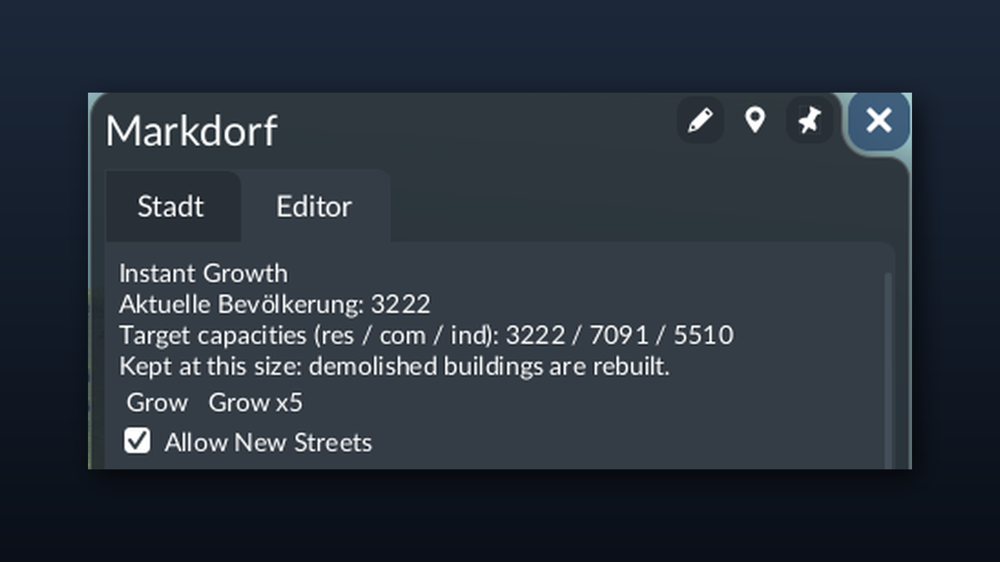

# Town: Instant Grow


A Transport Fever 3 script mod. Grow sandbox towns with one click, without building any transport. A grown town keeps its size: if you demolish buildings (for example to lay out streets), it rebuilds them.

Compatible with [Town Zoning](https://mod.io/g/transportfever3/m/town-zoning).



## Download

Get the latest `town-instant-grow-<version>.zip` from the [Releases page](https://github.com/Fabian-Kleine/tf3-town-instant-grow/releases/latest).

## Install

1. Close Transport Fever 3.
2. Open your user data folder: in the game's main menu, go to **Settings > Advanced > Open User Data Folder**. It usually is:

   ```
   C:\Program Files (x86)\Steam\userdata\<your Steam ID>\3493540\local\
   ```

3. Open the `staging_area` folder inside it (create it if it doesn't exist).
4. Extract the zip there. The zip already contains the `fabian_town_instant_grow` folder, so you should end up with:

   ```
   ...\3493540\local\staging_area\fabian_town_instant_grow\mod.json
   ```

   If you see `fabian_town_instant_grow\fabian_town_instant_grow\mod.json`, move the inner folder up one level.
5. Start the game, create or load a **sandbox** game, and enable **Town: Instant Grow** in the mod list.

To update, delete the old `fabian_town_instant_grow` folder and extract the new zip the same way. To uninstall, delete the folder. Towns keep their current size when you remove the mod from a savegame.

The staging area is the only folder for local mods the official docs name so far. It is meant for mod development, and a copy there wins over a published copy with the same id.

## Use

Open a town window in sandbox mode and go to the **Editor** tab. The **Instant Growth** card sits above the base game's cards:

| Control | Effect |
|---|---|
| Grow | Target district capacities x1.5, development on, buildings upgrade and spawn right away |
| Grow x5 | Five steps at once (about x7.6) |
| Allow New Streets | Lets the town lay out its own streets while growing. Off: it only builds along existing streets |
| Stop Keeping | The mod stops rebuilding this town. Its target capacities stay where they are |

## How it works

| File | Role |
|---|---|
| `content/town_instant_grow/town_instant_grow.gs.lua` | Registers the game script |
| `content/town_instant_grow/town_instant_grow.script.lua` | Engine side: handles the grow events, remembers grown towns in its saved state, checks them every 100 simulation updates and fires develop commands when built capacity is below target |
| `content/town_instant_grow/town_instant_grow_eow.res.lua` | Registers the card on `TownEowEditorExtensionPoint`, with the base game's `isSandboxMode` condition |
| `content/town_instant_grow/town_instant_grow_eow.script.lua` | The card (GUI side) |
| `content/town_instant_grow/town_instant_grow_common.lua` | Event names and tuning values (grow factor, check interval, burst sizes) |
| `strings.json` | English and German texts of the card. The keys are the English texts the card passes to `_()` |

Growth uses the same value as the base **Target District Capacities** card (`makeTownSetInitialLandUseCapacitiesCmd`), so you can still fine-tune a town there. The mod follows your edits instead of overwriting them. If you switch off **Enable Town Development** there, the mod leaves the town paused.

A town that can't reach its target (no free land) stops getting develop commands after 5 checks without change, and resumes when it loses buildings or you grow it again.

## Console test

With a real town entity id (shown in the debug info or via `api.engine.util.town.getClosestTown`):

```lua
api.cmd.sendCommand(api.cmd.makeScriptingSendEventCmd("", "TownInstantGrow", "TownInstantGrow_grow", { town = 123, steps = 1, allowStreets = true }))
```

## Releasing

The GitHub workflow in `.github/workflows/release.yml` checks the JSON and Lua syntax and builds the zip on every push and pull request (download it from the run's artifacts). Pushing a tag that starts with `v` also publishes a GitHub release with the zip attached:

```bash
git tag v1.0.0
git push origin v1.0.0
```

Raise `revision` in `fabian_town_instant_grow/mod.json` before tagging a new version.

The store images live in `fabian_town_instant_grow/_metadata/`: `0.png` is the cover in the mod browser grid, `1.png` and up are the gallery. All are 1920x1080 PNG, at most 8 MB each.
